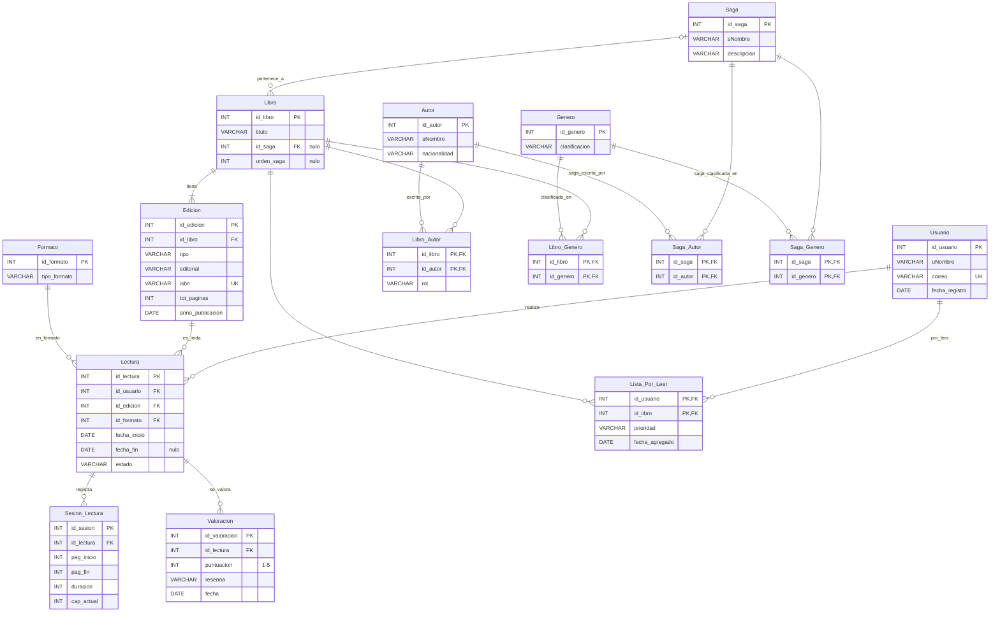

# Diagrama lógico: Biblioteca Virtual (Entrega #2)

Este es el modelo corregido de la Entrega #1. Las tablas nuevas son **Edicion**, **Saga_Autor** y **Saga_Genero**.

## Restricciones
- `Usuario.correo` y `Edicion.isbn` son únicos.
- `Valoracion.puntuacion` va de 1 a 5.
- `Lectura.estado` ∈ {por iniciar, en curso, terminada, abandonada}.
- `Lista_Por_Leer.prioridad` ∈ {Alta, Media, Baja}.
- `Sesion_Lectura`: `pag_fin ≥ pag_inicio`. Las páginas leídas se calculan como `pag_fin − pag_inicio` (vista `vw_sesion_paginas`).
- `fecha_registro`, `Valoracion.fecha` y `fecha_agregado` toman la fecha actual por defecto.
- Campos opcionales: `Lectura.fecha_fin`, `Libro.id_saga` y `Libro.orden_saga`.
